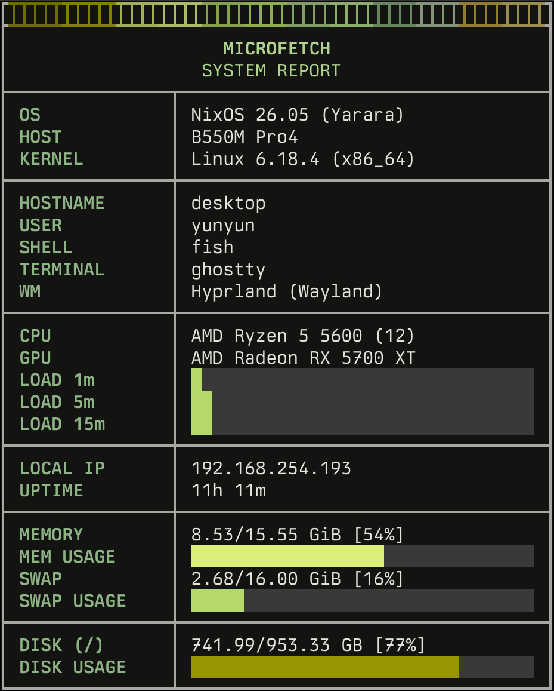

# MachineReport

Fast system fetch tool in Rust for Linux.

Fork of [microfetch](https://github.com/notashelf/microfetch) with improved GPU detection.

<p align="center">
  
</p>

## Features

- ~1ms execution time (~140x faster than fastfetch)
- ~412kb binary
- Minimal dependencies (only `libc`)
- Reliable GPU detection (AMD, NVIDIA, Intel, virtual GPUs)
- Respects `NO_COLOR`

## Installation

```bash
# Cargo
cargo install --git https://github.com/imaviso/machinereport.git

# Nix
nix run github:imaviso/machinereport

# From source
git clone https://github.com/imaviso/machinereport.git
cd machinereport && cargo build --release
```

## Usage

```bash
machinereport --title="MY MACHINE" # --title is required
machinereport --version
```

Titles longer than 50 characters overflow the table border.

## Acknowledgments

- [usgraphics/usgc-machine-report](https://github.com/usgraphics/usgc-machine-report) - Design inspiration
- [notashelf/microfetch](https://github.com/notashelf/microfetch) - Original project
- [fastfetch](https://github.com/fastfetch-cli/fastfetch) - GPU detection inspiration

## License

GPL3
